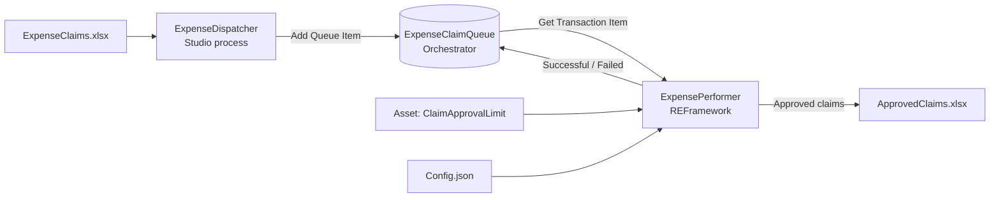

# Expense Claims Automation (UiPath)

An end-to-end **Dispatcher + Performer** automation built with **UiPath Studio**, **Orchestrator Queues** and the **Robotic Enterprise Framework (REFramework)**. Expense claims are read from an Excel file, loaded into an Orchestrator queue, then validated and processed one by one with proper business/system exception handling and automatic retries.

---

## Table of Contents

- [Overview](#overview)
- [Architecture](#architecture)
- [Tech Stack](#tech-stack)
- [Repository Structure](#repository-structure)
- [Prerequisites](#prerequisites)
- [Orchestrator Setup](#orchestrator-setup)
- [Configuration](#configuration)
- [Input File Format](#input-file-format)
- [Business Rules](#business-rules)
- [How to Run](#how-to-run)
- [Expected Output](#expected-output)
- [Exception Handling](#exception-handling)
- [Testing the Failure Paths](#testing-the-failure-paths)
- [Troubleshooting](#troubleshooting)
- [Author](#author)

---

## Overview

| Component | Role |
|---|---|
| **ExpenseDispatcher** | Reads `ExpenseClaims.xlsx` and adds each claim to the Orchestrator queue `ExpenseClaimQueue`. Duplicate claims are skipped. |
| **ExpensePerformer** | REFramework process that takes each queue item, validates it against business rules, writes approved claims to `ApprovedClaims.xlsx` and sets the transaction status. |
| **Orchestrator** | Hosts the queue, the approval-limit asset, the processes and an optional queue trigger. |

---

## Architecture



---

## Tech Stack

- UiPath Studio (project uses `UiPath.System.Activities` 26.10.0 and `UiPath.Excel.Activities` 3.6.1)
- UiPath Orchestrator (queues, assets, processes, triggers)
- REFramework (transactional process template)
- Excel (input and output files)
- VB.NET expressions

---

## Repository Structure

> Adjust folder names below if your repository layout differs.

```
Expense-Claims-UiPath-Project/
├── ExpenseDispatcher/
│   ├── Main.xaml                 # Reads Excel, adds queue items
│   └── project.json
├── ExpensePerformer/
│   ├── Main.xaml                 # REFramework state machine
│   ├── Process.xaml              # Business rules and claim approval
│   ├── Framework/                # InitAllSettings, InitAllApplications,
│   │                             # GetTransactionData, SetTransactionStatus, ...
│   ├── Data/
│   │   ├── Config.json           # Settings and constants
│   │   ├── Input/
│   │   └── Output/
│   └── project.json
└── README.md
```

---

## Prerequisites

1. UiPath Studio, connected to an Orchestrator tenant (Community Cloud works).
2. A machine and an unattended robot/user assigned to the Orchestrator folder.
3. Microsoft Excel is **not** required. The workflow uses the UiPath Excel activities that work without the Excel application.
4. Local folders for input and output, for example:
   - `C:\RPA\ExpenseClaims\Input`
   - `C:\RPA\ExpenseClaims\Output`

---

## Orchestrator Setup

Create everything below in one folder, for example `ExpenseClaims`.

| Resource | Name | Settings |
|---|---|---|
| Folder | `ExpenseClaims` | Assign your machine and user |
| Queue | `ExpenseClaimQueue` | **Enforce unique reference:** Yes · **Auto retry:** enabled, max 3 |
| Asset | `ClaimApprovalLimit` | Type **Integer**, value `50000` |

Then:

1. Connect Studio to the folder: **Home → Orchestrator Connection**.
2. Publish `ExpenseDispatcher` and `ExpensePerformer` to the Orchestrator feed.
3. In the folder, add both packages under **Automations → Processes**.
4. *(Optional)* Create a **Queue Trigger** for `ExpensePerformer` on `ExpenseClaimQueue` with **max 1 concurrent job**, because all jobs write to the same Excel file.

---

## Configuration

Settings live in `ExpensePerformer/Data/Config.json`.

```json
{
  "Settings": {
    "OrchestratorQueueName": "ExpenseClaimQueue",
    "OrchestratorQueueFolder": "ExpenseClaims",
    "logF_BusinessProcessName": "ExpenseClaimPerformer",
    "OutputFolderPath": "C:\\RPA\\ExpenseClaims\\Output",
    "OutputFileName": "ApprovedClaims.xlsx",
    "AllowedCategories": "Travel,Food,Lodging,Office,Training"
  },
  "Constants": {
    "MaxRetryNumber": 0,
    "MaxConsecutiveSystemExceptions": 0,
    "ExScreenshotsFolderPath": "Exceptions_Screenshots",
    "RetryNumberGetTransactionItem": 3,
    "RetryNumberSetTransactionStatus": 3,
    "ShouldMarkJobAsFaulted": false
  }
}
```

Notes:

- `MaxRetryNumber` is **0** on purpose. Retries for system errors are handled by the queue's **Auto retry**, so a non-zero value would retry twice.
- `ClaimApprovalLimit` is **not** in `Config.json`. It is read from the Orchestrator asset with **Get Asset** at the end of `InitAllSettings.xaml` and stored in `out_Config("ClaimApprovalLimit")`.
- Use doubled backslashes (`\\`) for Windows paths in JSON.

---

## Input File Format

`ExpenseClaims.xlsx`, sheet **`Claims`**, headers in row 1:

| ClaimID | EmployeeName | Category | Amount | Date |
|---|---|---|---|---|
| EC1001 | Priya Shah | Travel | 12500 | 2026-11-02 |
| EC1002 | Rahul Mehta | Food | 850 | 2026-11-03 |
| EC1003 | Anita Rao | Lodging | 18500 | 2026-11-04 |

Rules for the file:

- Every `ClaimID` must be **unique**. It is used as the queue item **Reference**, and a blank or duplicate value is rejected.
- Remove blank rows below the data, since a row without a `ClaimID` makes Add Queue Item fail with error 1850.
- `Amount` must be a number and `Date` a real Excel date.

---

## Business Rules

The Performer validates each claim in `Process.xaml`. Any failed rule throws a `BusinessRuleException`.

| # | Rule | Reason logged on failure |
|---|---|---|
| 1 | Category must not be empty | `Category is missing` |
| 2 | Category must be in `AllowedCategories` | `Category not allowed: <value>` |
| 3 | Amount must be numeric | `Amount is not numeric: <value>` |
| 4 | Amount must be greater than 0 | `Amount must be positive` |
| 5 | Amount must not exceed `ClaimApprovalLimit` | `Amount <value> exceeds approval limit` |

Claims that pass all rules are appended to `ApprovedClaims.xlsx` (sheet `Approved`) with the columns `ClaimID, Employee, Category, Amount, ClaimDate, ProcessedOn`.

---

## How to Run

1. Place `ExpenseClaims.xlsx` in the input folder and close it in Excel.
2. Delete any old `ApprovedClaims.xlsx` from the output folder for a clean run.
3. In Orchestrator, start the **ExpenseDispatcher** job (set `in_ClaimsFilePath` if your path differs from the default).
   - Check the job logs for `Dispatcher finished. Added: N, Skipped: M`.
4. Check **Queues → ExpenseClaimQueue → Transactions**. The items should be **New**.
5. Start **ExpensePerformer**, or let the Queue Trigger start it.
6. Watch the items move to **Successful** or **Failed**.

You can also run both projects directly from Studio with **Debug**, as long as Studio is connected to the correct Orchestrator folder.

---

## Expected Output

For a clean input file with 10 valid claims:

- Dispatcher log: `Added: 10, Skipped: 0`
- Queue: 10 items with status **Successful**
- `ApprovedClaims.xlsx`: 10 rows under the header row

---

## Exception Handling

| Exception | Queue status | Retried? |
|---|---|---|
| `BusinessRuleException` | Failed, type **Business** | No |
| Any other exception | Failed, type **Application** | Yes, up to 3 times by the queue's Auto retry |
| Duplicate reference in Dispatcher | Logged as a warning and skipped | n/a |

---

## Testing the Failure Paths

To verify the business-rule handling, use a test input that deliberately includes bad rows:

| Case | Example | Expected result |
|---|---|---|
| Over the limit | Amount `62000` | Failed (Business) |
| Missing category | Category blank | Failed (Business) |
| Non-numeric amount | Amount `abc` | Failed (Business) |
| Negative amount | Amount `-500` | Failed (Business) |
| Invalid category | Category `Gaming` | Failed (Business) |
| Duplicate claim | Same `ClaimID` twice | Second one skipped by the Dispatcher |

To test the retry path, temporarily throw `New Exception("Simulated system error")` for one claim in `Process.xaml`. The item should show **Failed (Application)** and be retried up to 3 times.

---

## Troubleshooting

| Symptom | Likely cause and fix |
|---|---|
| `Reference is required for Unique Reference Queues` (error 1850) | A row has a blank `ClaimID`, or the **Reference** property of Add Queue Item is empty. Remove blank rows and set Reference to `row("ClaimID").ToString`. |
| Queue not found | Studio is connected to a different folder, or `OrchestratorQueueName` is misspelled. |
| `Cannot assign from type 'System.String' to type 'System.Double'` | The amount text must be assigned to the String variable `amountText`, not to the Double `amount`. |
| Key not found for `ClaimApprovalLimit` | The Get Asset step is missing in `InitAllSettings.xaml`, or the asset name or folder is wrong. |
| All claims fail with a business reason | Read the **Reason** on the failed queue item and check `AllowedCategories` and the asset value. |
| Excel file is locked | Close `ApprovedClaims.xlsx` and keep the trigger at max 1 concurrent job. |
| Items stuck **In Progress** | The job was stopped before the status was set. They become **Abandoned** after a while. |

---

## Author

**Anuraj**: [github.com/Anuraj4](https://github.com/Anuraj4)

Repository: <https://github.com/Anuraj4/Expense-Claims-UiPath-Project>
